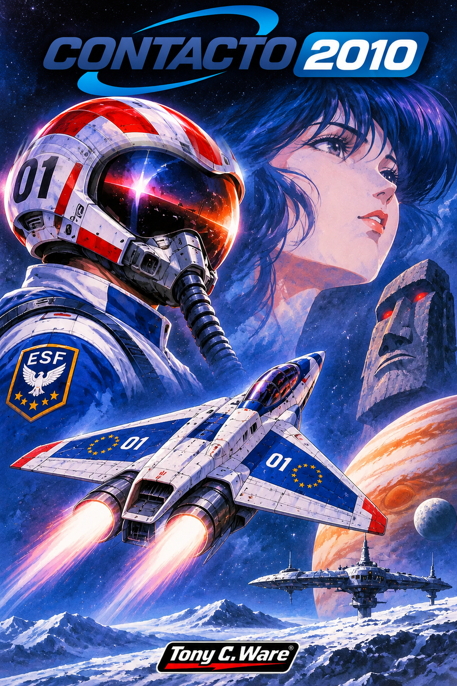
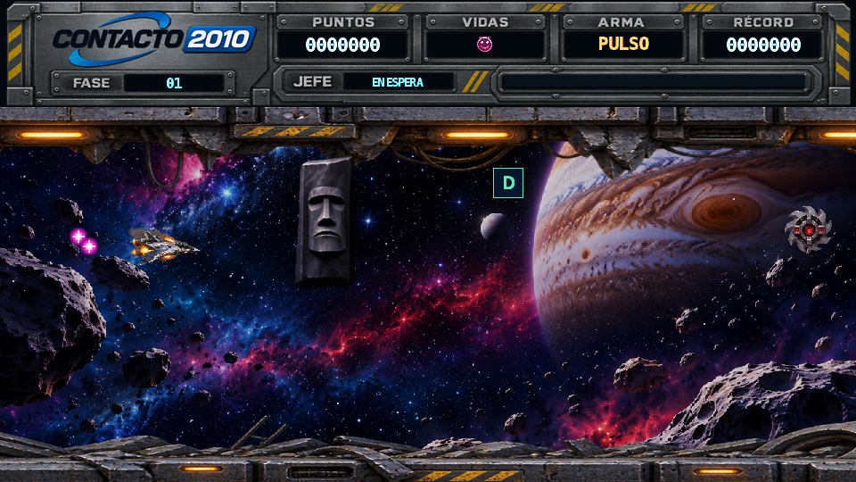

# CONTACTO 2010 · V1.3

**Tony C. Ware · GRIT NOVA ENGINE · Música original de FutureDark.** Juego arcade horizontal de ciencia ficción para Linux x86_64/Bazzite y Windows x64, desarrollado en C++17 y SDL2. Programación y desarrollo: GPT-6 · OpenAI.

## NUEVA EDICIÓN OFICIAL V1.3

La **portada oficial V1.3** representa a la **Firebird-01 de dos alas**, con los colores industriales aprobados, el traje del piloto con visor y el logotipo oficial CONTACTO 2010. Su original es un PNG **4096 × 6144**. La portada anterior se conserva únicamente como variante artística histórica.

Se han renovado la carátula del repositorio, los iconos Linux/Windows, el logotipo del juego y el **atlas oficial V1.3 (45 páginas)**, con primera página renovada, lámina industrial a página completa y un nuevo anexo de carátulas. Se mantienen todas las capturas reales y no se revela el desenlace.

## Descargar y jugar

[**Release oficial V1.3 — todas las descargas**](https://github.com/OnRail76/Contacto-2010/releases/tag/v1.3)

- [**Linux x86_64 / Bazzite — AppImage**](https://github.com/OnRail76/Contacto-2010/releases/download/v1.3/Contacto_2010_V1.3-x86_64.AppImage). Dar permiso de ejecución con `chmod +x` y abrir.
- [**Windows 64 bits — ejecutable nativo en ZIP**](https://github.com/OnRail76/Contacto-2010/releases/download/v1.3/CONTACTO_2010_V1.3_WINDOWS_x64.zip). Descomprimir todo y abrir `CONTACTO_2010.exe`.
- [**Atlas oficial V1.3 (45 páginas, sin spoilers)**](documentacion/CONTACTO_2010_V1.3_ATLAS_MEMORIA_MANUAL_GRIT_NOVA.pdf).
- [**Carátula oficial original 4096 × 6144 PNG**](documentacion/CONTACTO_2010_CARATULA_OFICIAL_4K.png).

## El juego

**Cinco fases completas**, combates arcade y jefes propios, Firebird-01, Cementerio de Escombros V2, HUD militar y escudo. Se conserva la **escena final corregida en los colores oficiales**. El piloto de la Firebird-01 utiliza su retrato **fijo con visor opaco**, mientras que **AURA-01** mantiene sus 12 fotogramas y diálogos originales.

Banda sonora FutureDark de diez pistas OGG estéreo a 44,1 kHz, efectos con panorámica espacial, reproductor de cassette animado, medidores L/R y scanlines CRT configurables.

**Controles:** WASD o cursores para mover, ESPACIO para disparar, ESC pausa, F11 pantalla completa. Compatible con mando SDL2 y reconexión.

## Proyecto y documentación

- [Atlas, memoria y manual V1.3](documentacion/CONTACTO_2010_V1.3_ATLAS_MEMORIA_MANUAL_GRIT_NOVA.pdf)
- [Historial consolidado de versiones](HISTORIAL_VERSIONES.md)
- [Ficha de la computadora AURA-01](documentacion/AURA-01_COMPUTADORA_FIREBIRD.md)
- `fuentes/`: lógica del juego en C++17/SDL2.
- `motor/`: núcleo reutilizable de GRIT NOVA ENGINE.
- `assets/`: sprites y recursos de juego, incluida la escena final oficial y el retrato con visor.
- `banda_sonora_original/`: música OGG estéreo original.
- `packaging/`: iconos y compilación de distribuciones Linux/Windows.
- `documentacion/PORTADA_OFICIAL_ANTERIOR_V1.2.1.png`: carátula anterior, archivada como variante y no oficial vigente.

Compilar Linux: `bash COMPILAR_LINUX.sh`. Compilar Windows: MSYS2 UCRT64 y `bash packaging/windows/COMPILAR_WINDOWS.sh`.

El código se distribuye bajo **MIT** (`LICENSE`). Arte, marcas y banda sonora conservan sus condiciones específicas descritas en `LICENCIA_RECURSOS.md`.
