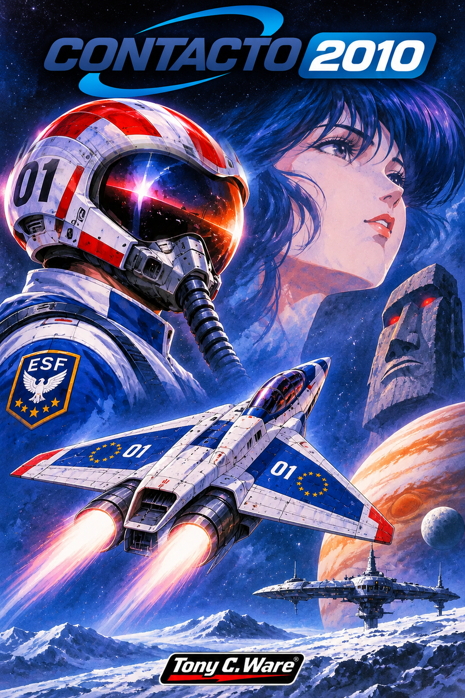

# CONTACTO 2010 · V1.3 — NUEVA EDICIÓN OFICIAL

**Tony C. Ware · GRIT NOVA ENGINE · Música original: FutureDark**

La nueva **carátula oficial CONTACTO 2010** sustituye a las anteriores en el README, la identidad de distribución, los iconos Linux/Windows y el atlas. La ilustración maestra tiene **4096 × 6144 píxeles**, el logotipo oficial, colores industriales azul/blanco/rojo y la **Firebird-01 de dos alas**. La portada anterior queda conservada como variante artística, no como portada vigente.

El **atlas/memoria/manual V1.3** contiene **45 páginas**, con una portada rehecha y una página de archivo artístico añadida. Mantiene las capturas reales, lámina industrial, instrucciones, créditos y la protección frente a spoilers.

## Descargas

- Linux x86_64 / Bazzite: `Contacto_2010_V1.3-x86_64.AppImage`
- Windows x64: `CONTACTO_2010_V1.3_WINDOWS_x64.zip`
- Atlas oficial actualizado: `CONTACTO_2010_V1.3_ATLAS_MEMORIA_MANUAL_GRIT_NOVA.pdf`
- Original artístico PNG Ultra HD: `CONTACTO_2010_CARATULA_OFICIAL_4K.png`
- PNG de referencia del logotipo, retrato estático del piloto con visor y portada previa como archivo artístico
- Archivo `SHA256_CONTACTO_2010_V1.3.txt` para verificar la integridad

## Juego y motor

**No cambian las cinco fases ni el sistema de juego.** Se mantienen la escena final con los colores oficiales, el piloto con visor fijo, AURA-01 con animación RGBA de 12 fotogramas, la música FutureDark OGG estéreo y los efectos espaciales, el cassette animado y las scanlines CRT. Ejecutables nativos compilados y sometidos a pruebas automatizadas en GitHub Actions.

**Licencias:** código MIT. Música, marca e ilustraciones sujetos a los derechos descritos en `LICENCIA_RECURSOS.md`.

[Historial consolidado de versiones](https://github.com/OnRail76/Contacto-2010/blob/main/HISTORIAL_VERSIONES.md).
